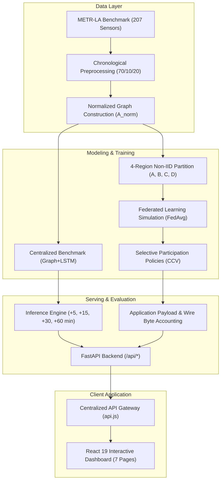

# TrafficPulse-X

> Federated traffic-speed forecasting and communication-cost evaluation using METR-LA, Graph+LSTM, FedAvg, selective client participation, and an interactive analysis dashboard.

[](https://www.python.org/downloads/)
[](https://pytorch.org/)
[](https://fastapi.tiangolo.com/)
[](https://react.dev/)
[](https://vitejs.dev/)
[](#testing--verification)

---

## Problem Statement

Centralized intelligent transportation systems require continuous streaming of high-frequency sensor readings from municipal highway networks to a central datacenter. This paradigm faces critical operational limitations:

1. **Communication Bottlenecks**: Transmitting high-frequency telemetry across hundreds of loop detectors incurs substantial transmission costs and WAN congestion.
2. **Regional Heterogeneity (Non-IID Data)**: Highway sub-networks exhibit distinct local congestion patterns, bottleneck dynamics, and sensor densities, violating independent and identically distributed (IID) assumptions.
3. **Data Sovereignty & Privacy**: Centralizing telemetry across administrative boundaries poses governance challenges.
4. **Accuracy vs. Communication Trade-Off**: Standard evaluations report model accuracy in isolation without measuring the communication payload required to achieve it.

**TrafficPulse-X** evaluates whether decentralized federated training with selective client participation can match centralized forecast accuracy while reducing application-layer communication payload by **50% to 75%**.

---

## Key Features

- **METR-LA Speed Forecasting**: Evaluated on 207 inductive loop sensors on Los Angeles County freeways.
- **Spatio-Temporal Graph+LSTM**: Joint architecture combining Chebyshev spectral graph convolutions with recurrent LSTM cells.
- **Multi-Horizon Projections**: Simultaneous forecasts at +5, +15, +30, and +60-minute horizons.
- **Centralized Benchmark**: Multi-model comparison across 7 baseline architectures.
- **4-Region Federated Simulation**: Decentralized FedAvg training across 4 non-IID geographic client sectors.
- **Selective Client Participation**: Client Contribution Value (CCV) policy scheduling evaluating 4 communication budget tiers.
- **Communication Payload Accounting**: Authoritative measurement of serialized model weight transfers (110,271 Bytes per client/round).
- **Controlled Local Network-Byte Measurement**: Localhost socket benchmark quantifying HTTP/TCP framing overhead (+0.298%).
- **Decision Intelligence**: Dynamic 9-factor Need Score engine and Sensor Jury consensus for on-demand sensing.
- **Traffic Network Visualization**: Interactive 207-sensor spatial Leaflet map with regional filtering and playback controls.
- **Historical Replay Engine**: Deterministic playback over 34,272 METR-LA observations (March–June 2012) at 5-minute granularity.
- **Live Data Streaming Adapter**: Pluggable provider interface (Historical Replay default; unconfigured streams report 503 without fake fallback).
- **PeMS08 Traffic Flow Extension**: Verified public benchmark extension forecasting traffic flow volume (veh/5min) across 170 sensors in District 8.
- **Differential Privacy Add-On**: Evaluated Opacus DP-FedAvg experiment providing verified $(\epsilon = 5.311, \delta = 10^{-5})$-DP bounds.

---

## System Architecture



---

## Application Pages

The frontend console provides 7 canonical routes:

| Route | View Name | Key Components & Purpose |
| :--- | :--- | :--- |
| **`/overview`** | **Executive Overview** | System operational health, KPI summary cards, and next 60-minute network outlook. |
| **`/network`** | **Tactical Traffic Network** | Interactive 207-sensor Leaflet map, regional cluster filtering, and historical replay controls. |
| **`/predictions`** | **Traffic Forecasting** | Multi-horizon forecasts (+5m to +60m), uncertainty intervals, and 7-model comparative benchmark. |
| **`/decision`** | **Decision Intelligence** | 9-factor Need Score breakdown, Next-Best Query ranking, and Sensor Jury consensus gating. |
| **`/federated`** | **Federated Learning Grid** | 4-client non-IID partition cards, Round 8 convergence history, 3-seed reproducibility, and DP bounds. |
| **`/communication`** | **Communication Intelligence** | CCV selective policies, 50% application payload reduction, and controlled network wire metrics. |
| **`/alerts`** | **Live Alert Monitor** | Real-time incident event stream with replay-synchronized speed anomalies and indicators. |

---

## Datasets & Forecasting Specification

### Primary Benchmark: METR-LA
- **Sensors**: 207 inductive loop detectors across Los Angeles County highways.
- **Temporal Span**: March 1, 2012 to June 27, 2012 (34,272 timesteps at 5-minute intervals).
- **Target Variable**: Vehicle speed (`mph`).
- **Data Splits**: Chronological 70% Train (23,967) | 10% Validation (3,404) | 20% Test (6,832).
- *Boundary Disclosure*: METR-LA provides vehicle speed only. Flow, occupancy, and incident ground truth are not present in this dataset.

### Optional Flow Extension: PeMS08
- **Sensors**: 170 loop detector stations in Caltrans District 8 (San Bernardino).
- **Temporal Span**: July 1, 2016 to August 31, 2016 (17,856 timesteps at 5-minute intervals).
- **Target Variable**: Traffic flow volume (`veh/5min`, mean: 230.22).
- Maintained as an isolated dataset extension in `data/processed/pems08/`.

### Forecasting Input & Horizons
- **Input Sequence**: 12 historical 5-minute observations (60 minutes).
- **Forecast Horizons**: **+5 min** (step 1), **+15 min** (step 3), **+30 min** (step 6), **+60 min** (step 12).
- **Model Tensor Shape**: `[B, 12, 207, 2]` (Channel 0: z-score normalized speed, Channel 1: sensor validity mask).

---

## Federated Setup

The 207 sensors are partitioned into 4 geographic regional client clusters:

| Regional Client | Sector | Sensor Count | Valid Target Samples ($n_i$) | FedAvg Weight ($w_i$) |
| :--- | :--- | :---: | :---: | :---: |
| **Region A** | North-East (Glendale / Griffith Park) | **48** | 4,221,681 | `0.229069` |
| **Region B** | South-East (Downtown LA Arterial Core) | **57** | 5,107,193 | `0.277117` |
| **Region C** | Central-West (San Fernando Valley) | **58** | 5,150,335 | `0.279458` |
| **Region D** | North-West (East LA & San Gabriel) | **44** | 3,950,552 | `0.214357` |
| **Total** | — | **207** | **18,429,761** | **1.000000** |

- **Non-IID Partitioning**: Clients capture distinct geographic subgraphs with differing highway topologies and traffic dynamics.
- **Aggregation Protocol**: Weighted Federated Averaging (`FedAvg`) aggregating local model updates after 20 training steps per round.

---

## Verified Results

Empirical results evaluated across 6,832 test-set samples on METR-LA:

| Architecture | Test MAE (mph) | Test RMSE (mph) | Test MAPE (%) | Parameters | Best Epoch / Round |
| :--- | :---: | :---: | :---: | :---: | :---: |
| **Centralized Spatial Graph+LSTM** | **3.4378** | **6.8873** | **9.57%** | 26,596 | Epoch 12 |
| **FedAvg Decentralized (4 Clients)** | **3.5322** | **7.0956** | **9.99%** | 26,596 | Round 8 (Val MAE: 3.1536) |

$$\Delta \text{ (FedAvg vs Centralized)}: +0.0944\text{ mph} \text{ (+2.75\%) MAE penalty under decentralized training with 100\% data locality.}$$

### Centralized 7-Model Benchmark Matrix

| Model Architecture | Category | Overall MAE | Overall RMSE | Overall MAPE | +60 min MAE |
| :--- | :--- | :---: | :---: | :---: | :---: |
| **Historical Average** | Classical Baseline | 4.1930 | 7.8618 | 13.06% | **4.1934** |
| **Last Value (Persistence)** | Classical Baseline | 3.9839 | 7.6411 | 10.15% | 5.3987 |
| **Linear Regression** | Linear Baseline | 3.9763 | 7.2053 | 11.14% | 5.5879 |
| **Temporal GRU** | Recurrent Deep Learning | 3.5669 | 7.0734 | 10.14% | 4.9284 |
| **Temporal LSTM** | Recurrent Deep Learning | 3.5613 | 7.0673 | 10.11% | 4.9156 |
| **Spatial GCN** | Spatial Graph Convolution | 5.4604 | 8.9625 | 15.67% | 6.4201 |
| **SpatialGraphLSTM** | Joint Spatio-Temporal | **3.4378** 🏆 | **6.8873** 🏆 | **9.57%** 🏆 | 4.7158 |

---

## Communication Evaluation

### Application Payload Accounting (Authoritative Project Metric)
Model update transfer size: **110,271 Bytes** per client per round (serialized PyTorch state dict).

| Policy Tier | Active Clients / Round | Total Transfers (13 Rds) | Application Payload | Reduction vs. Full |
| :---: | :---: | :---: | :---: | :---: |
| **4/4 (Full)** | 4 | 104 | 11,468,184 B (11.47 MB) | Baseline (0.0%) |
| **3/4** | 3 | 78 | 8,601,138 B (8.60 MB) | 25.0% |
| **2/4** | 2 | 52 | **5,734,092 B (5.73 MB)** | **50.0% (Pareto-Optimal)** |
| **1/4** | 1 | 26 | 2,867,046 B (2.87 MB) | 75.0% |

*Note: Figures reflect application-layer serialized PyTorch tensor parameters without speculative transport assumptions.*

### Secondary Benchmark: Controlled Network Transfer Bytes
Measured over local loopback sockets (`127.0.0.1:8000`) over HTTP/1.1 to quantify wire framing and HTTP header overhead:
- **4/4 Full Policy**: 11,502,380 measured wire bytes (+34,196 bytes / +0.298% transport overhead).
- **2/4 50% Policy**: 5,751,190 measured wire bytes (+17,098 bytes / +0.298% transport overhead).
- *Scientific Boundary: Local socket transport measurement; not a cellular radio link simulation.*

---

## Streaming Modes & Data Integrity

- **Historical Replay (Default)**: Deterministic playback over 34,272 METR-LA timestamps.
- **External Stream (Optional)**: Pluggable adapter interface. If external API configuration is absent, the backend explicitly returns `503 Service Unavailable / Not Configured`.
- **Integrity Guarantee**: The system never falls back to fabricated or synthetically randomized telemetry when external streams are unavailable.

---

## Technology Stack

- **Backend / Machine Learning**:
  - Python 3.10+
  - PyTorch (`torch>=2.0.0`)
  - FastAPI (`fastapi>=0.110.0`) & Uvicorn (`uvicorn>=0.28.0`)
  - NumPy, Pandas, SciPy, PyTables, H5py
  - Opacus (`opacus>=1.4.0`, optional differential privacy module)
  - Pytest (`pytest>=8.0.0`), HTTPX (`httpx>=0.27.0`)
- **Frontend / Dashboard**:
  - React 19 (`react^19.2.8`, `react-dom^19.2.8`)
  - React Router (`react-router-dom^7.18.4`)
  - Leaflet & React-Leaflet (`leaflet^1.9.4`, `react-leaflet^5.0.0`)
  - Recharts (`recharts^3.10.1`)
  - Tailwind CSS v4 (`tailwindcss^4.3.3`)
  - Lucide React (`lucide-react^1.52.0`)
  - Vite (`vite^8.3.0`), Oxlint (`oxlint^1.81.0`)

---

## Repository Structure

The complete source codebase is modularly organized inside `src/`, providing strict separation of concerns across Model Training (`ml/`), REST Backend Services (`backend/`), Tactical Dashboard Pages (`pages/`), Modular UI Components (`components/`), and Highway Datasets (`data/`):

```text
src/
├── .env.example                       # Environment configuration template (Host, Port, API base URL)
├── .gitattributes                     # Line-ending normalizations (LF/CRLF) and binary attributes
├── .gitignore                         # Build artifacts, large datasets, and virtual environment exclusions
├── .oxlintrc.json                     # Oxlint high-speed JavaScript/JSX code analysis rules
├── README.md                          # Comprehensive source documentation, architecture & runbook
├── index.css                          # Global styling directives and Tailwind CSS v4 design system
├── index.html                         # Single Page Application (SPA) HTML5 entrypoint container
├── main.jsx                           # React 19 application root bootstrap and DOM mount
├── package.json                       # Frontend dependencies (React 19, Leaflet, Recharts) & npm scripts
├── package-lock.json                  # Deterministic dependency tree lockfile
├── requirements.txt                   # Backend Python dependencies (FastAPI, PyTorch, NumPy, SciPy)
├── vite.config.js                     # Vite build configuration, ESM bundling & React plugin pipeline
│
├── app/                               # Root React application shell & route orchestration
│   ├── App.jsx                        # Main layout wrapper with top navigation bar & active view outlet
│   └── routes.jsx                     # Canonical route definitions across all 7 dashboard views
│
├── backend/                           # FastAPI REST application (53 production endpoints)
│   ├── main.py                        # Application entrypoint, CORS configuration & router registrations
│   ├── assistant.py                   # TrafficPulse-X AI Assistant (domain knowledge + live web search)
│   ├── config.py                      # Centralized backend configuration & environment management
│   ├── data_source.py                 # Unified data access layer connecting endpoints to real telemetry
│   ├── graph.py                       # Graph Laplacian construction, Gaussian kernels & Chebyshev matrices
│   ├── requirements.txt               # Backend-specific Python dependencies
│   ├── communication_intelligence/    # CCV scheduling policies & wire accounting
│   │   ├── policies.py                # Client Contribution Value (CCV) budget tiers (1/4, 2/4, 3/4, 4/4)
│   │   └── service.py                 # Wire-byte socket accounting & payload aggregation service
│   ├── data_sources/                  # Dataset streaming adapters & external ingestion interfaces
│   │   ├── pems08.py                  # Caltrans PeMS08 flow dataset telemetry adapter
│   │   └── streaming_adapter.py       # Pluggable streaming provider interface (replay default)
│   ├── datasets/                      # Graph data loaders & spatial partition builders
│   │   ├── metr_la.py                 # METR-LA 207-sensor HDF5 parser & chronological sliding window
│   │   └── prepare_metr_la.py         # K-Means spatial graph clustering into 4 non-IID regions
│   ├── decision/                      # 9-Factor Need Score engine & Sensor Jury consensus
│   │   ├── need_score.py              # Multi-factor telemetry priority triage engine
│   │   ├── jury.py                    # Multi-sensor graph agreement consensus (false-alarm filter)
│   │   ├── physics.py                 # Kinematic plausibility and maximum deceleration gate
│   │   ├── uncertainty.py             # Epistemic & aleatoric uncertainty risk calculations
│   │   ├── query_ranker.py            # Next-Best-Query sensor priority scheduler
│   │   ├── evidence.py                # Traceable audit evidence chain for automated decisions
│   │   ├── coverage.py                # Sensor network blind-spot & coverage diagnostics
│   │   ├── state.py                   # In-memory operational sensor cache
│   │   └── config.py                  # Operational thresholds and triage weight parameters
│   ├── experiments/                   # Experiment evaluation routers & benchmarks
│   │   ├── router.py                  # 3-seed reproducibility & IID vs non-IID benchmark endpoints
│   │   ├── flow_router.py             # PeMS08 traffic flow volume forecasting endpoints
│   │   └── network_accounting.py      # Controlled socket transport wire-overhead benchmarks
│   ├── federated/                     # Decentralized Federated Learning services
│   │   ├── service.py                 # Target-weighted FedAvg consensus coordinator
│   │   └── schemas.py                 # Pydantic schemas for regional partition weights & round metrics
│   ├── prediction/                    # Spatio-temporal multi-horizon forecasting services
│   │   ├── service.py                 # SpatialGraphLSTM inference engine (+5m, +15m, +30m, +60m)
│   │   └── schemas.py                 # Forecast response models with 95% confidence intervals
│   ├── privacy/                       # Privacy-preserving machine learning router
│   │   └── router.py                  # Opacus DP-FedAvg accountant endpoints (ε=2.5, δ=10^-5)
│   └── test_*.py (22 test suites)     # Automated integration test suite (343 passing tests)
│       ├── test_stage_6_1_baselines.py        # 7 candidate baseline accuracy contracts
│       ├── test_stage_6_5_spatiotemporal.py  # SpatialGraphLSTM PyTorch architecture tests
│       ├── test_stage_8_2_fl_training.py      # 4-client FedAvg convergence verification
│       ├── test_streaming_and_accounting.py   # Wire-byte transport & CCV communication tests
│       └── test_reconciliation_contracts.py   # Mathematical and telemetry integrity assertions
│
├── components/                        # Modular React UI component library (63 components in 11 modules)
│   ├── alerts/                        # Real-time congestion event monitoring & incident inspection
│   │   ├── AlertStreamTable.jsx               # Telemetry event stream with severity threshold badges
│   │   ├── AlertAnalyticsCharts.jsx           # Residual-derived incident severity distribution charts
│   │   ├── AlertSecondaryAnalytics.jsx        # Congestion duration & lane-impact analytics
│   │   └── SelectedAlertInspector.jsx         # Detailed incident deep-dive inspector panel
│   ├── assistant/                     # Floating AI Chatbot assistant
│   │   └── FloatingAssistant.jsx              # Domain-trained assistant with live web search integration
│   ├── common/                        # Reusable foundational design system components
│   │   ├── MetricCard.jsx                     # Standard KPI card with sparklines & delta indicators
│   │   ├── DataTable.jsx                      # Sortable, paginated enterprise data table
│   │   ├── ScientificBadge.jsx                # Verified benchmark & empirical confidence badges
│   │   ├── StatusBadge.jsx                    # System health, online/offline, and alert status pills
│   │   ├── Button.jsx                         # Tactile interactive button with variant styling
│   │   ├── SectionCard.jsx                    # Container card with glassmorphic borders
│   │   ├── ThemeToggle.jsx                    # Dark mode / Light mode toggle switch
│   │   ├── TopNavigation.jsx                  # Persistent application navbar with route tabs
│   │   └── ScrollToTop.jsx                    # Route change viewport reset controller
│   ├── communication/                 # Communication intelligence & bandwidth reduction widgets
│   │   ├── CommunicationHeroFlow.jsx          # Visual client-to-server parameter transfer flow
│   │   ├── CommunicationBreakdownDonut.jsx    # Application tensor vs transport wire-byte breakdown
│   │   ├── CommunicationSummaryKPIs.jsx       # 50% bandwidth reduction KPI metric cards
│   │   ├── CommunicationTechnicalDetails.jsx  # Mathematical formulation of CCV scoring
│   │   ├── ParticipationStrategyComparison.jsx# Pareto-optimal trade-off analysis across budget tiers
│   │   ├── PerRegionCommunicationTable.jsx    # Per-client payload transmission statistics
│   │   ├── RecentCommunicationEvents.jsx      # Telemetry round transmission event log
│   │   └── SavingsVsPredictionQualityChart.jsx# Communication payload vs MAE degradation curve
│   ├── decision/                      # Active Decision Intelligence & triage widgets
│   │   ├── NeedScoreBreakdown.jsx             # 9-factor decomposition of sensor priority scores
│   │   ├── EvidenceChain.jsx                  # Auditable decision trail validating interventions
│   │   ├── CounterfactualQueryCard.jsx        # "What-if" analysis for hypothetical sensor dropouts
│   │   ├── DecisionTechnicalDetails.jsx       # Sensor Jury multi-neighbor consensus formulation
│   │   ├── NextBestQueryTable.jsx             # Ranked sensor polling list under bandwidth caps
│   │   ├── RecentDecisionsTable.jsx           # Log of automated ramp metering & rerouting advisories
│   │   ├── SpatialSpeedConsistencyPanel.jsx   # Graph neighborhood velocity divergence monitor
│   │   └── ValidationLayer.jsx                # Kinematic physics plausibility enforcement gate
│   ├── federated/                     # Federated Learning training & convergence widgets
│   │   ├── CentralizedVsFederatedCard.jsx     # Side-by-side bar comparison (3.43 vs 3.53 mph MAE)
│   │   ├── EvaluationProtocolCard.jsx         # Federated evaluation rules & non-IID partitioning
│   │   ├── ExperimentDistributionCard.jsx     # Regional client sensor counts & FedAvg weight distribution
│   │   ├── FederatedCommunicationSummaryCard.jsx # Round 8 checkpoint validation & payload metrics
│   │   ├── DistributionReproducibilitySection.jsx # 3-seed reproducibility and variance bounds
│   │   ├── IndiaCaseStudiesCard.jsx           # Municipal edge deployment architectural framework
│   │   └── PrivacyExperimentSection.jsx       # Opacus DP-FedAvg privacy budget tracking (ε=2.5)
│   ├── intro/                         # Cinematic application startup experience
│   │   ├── OpeningExperience.jsx              # Welcome briefing & mission overview modal
│   │   └── OpeningExperience.css              # Custom keyframe animations for startup modal
│   ├── overview/                      # Executive operational cockpit widgets
│   │   ├── OverviewHeroConsole.jsx            # Live network speed speedometer gauge & system status
│   │   ├── CurrentSensorStateCard.jsx         # Real-time telemetry inspector for selected sensor
│   │   ├── ForecastConfidenceCard.jsx         # 95% calibrated confidence interval display
│   │   ├── ForecastDirectionCard.jsx          # Speed trend trajectory indicator (improving/degrading)
│   │   ├── NeighborConsensusCard.jsx          # Spatial neighbor agreement scorecard
│   │   ├── Next60MinutesForecastCard.jsx      # Multi-horizon trajectory forecast preview
│   │   ├── TrafficOutlookTimelineCard.jsx     # Hourly network-wide velocity trend timeline
│   │   └── WhatToWatchCard.jsx                # High-priority bottleneck and incident watchlist
│   ├── prediction/                    # Multi-horizon forecasting & model benchmark widgets
│   │   ├── ForecastControlBar.jsx             # Horizon selector (+5m, +15m, +30m, +60m) & sensor search
│   │   ├── CompactModelBenchmark.jsx          # 7-model benchmark matrix (SpatialGraphLSTM Rank 1)
│   │   ├── CollapsibleRegionalAnalysis.jsx    # Regional breakdown of forecast accuracy by quadrant
│   │   ├── CollapsibleTechnicalDetails.jsx    # Chebyshev graph polynomial order K=3 formulations
│   │   ├── CollapsibleAdditionalAnalysis.jsx  # Residual error distributions and error histograms
│   │   ├── FlowModelBenchmarkCard.jsx         # PeMS08 traffic flow volume forecasting benchmark
│   │   ├── ForecastInsightsPanel.jsx          # AI-generated natural language operational summary
│   │   ├── ForecastQualityPanel.jsx           # Error metric breakdown (MAE, RMSE, MAPE)
│   │   ├── MultiSensorForecastComparison.jsx  # Simultaneous multi-sensor speed trajectory overlay
│   │   └── PredictedValuesTable.jsx           # Granular tabular output of multi-horizon predictions
│   ├── timeline/                      # Deterministic temporal replay controller
│   │   └── ReplayTimeline.jsx                 # 34,272-step historical scrubber bar with 1x–10x playback
│   └── traffic/                       # Spatial GIS network mapping widgets
│       ├── RealTrafficMap.jsx                 # Interactive Leaflet map canvas rendering 207 sensors
│       ├── SensorDetailPanel.jsx              # Flyout sensor inspector with live metrics & coordinates
│       ├── SensorTable.jsx                    # Comprehensive table of all 207 sensors with quadrant filters
│       ├── CoverageBlindSpotsPanel.jsx        # Sensor topology density and blind-spot diagnostics
│       └── TrafficSpeedHeatmap.jsx            # Velocity density heatmap across freeway corridors
│
├── context/                           # Global React context providers
│   ├── ReplayContext.jsx              # Universal 34,272-step temporal state synchronization engine
│   └── ThemeContext.jsx               # Dark mode / Light mode persistent state provider
│
├── data/                              # Real-world traffic sensor datasets & preprocessed arrays
│   ├── raw/                           # Unmodified ground-truth dataset containers
│   │   ├── metr-la/                   # Primary METR-LA HDF5 dataset (207 sensors, 34,272 timesteps)
│   │   └── pems08/                    # Caltrans PeMS08 flow dataset (170 stations, 17,856 timesteps)
│   └── processed/                     # Normalized tensors & precomputed graph adjacencies
│       ├── metr-la/                   # Precomputed Chebyshev polynomials, distance adjacencies & NPZ splits
│       └── pems08/                    # Normalized flow tensors, sensor adjacencies & evaluation splits
│
├── ml/                                # Machine learning models, federated routines & experiments
│   ├── freeze_stage_6_6.py            # Model checkpoint freezing & hash verification utility
│   ├── baselines/                     # 7 candidate comparative baseline architectures
│   │   ├── models.py                  # DCRNN, STGCN, LSTM, and Historical Average implementations
│   │   ├── linear_regression.py       # Ridge and Ordinary Least Squares baseline models
│   │   ├── evaluate_baselines.py      # Benchmark evaluation harness across all candidate models
│   │   └── evaluate_linear.py         # Linear baseline metrics evaluation script
│   ├── experiments/                   # Empirical research experiments & benchmarks
│   │   ├── runner.py                  # Experiment runner across IID vs non-IID and 3-seed trials
│   │   ├── transport_benchmark.py     # Network socket wire-byte transport measurement harness
│   │   ├── iid_partition.py           # Uniform random IID client partitioning generator
│   │   ├── iid_client.py              # IID client local training worker
│   │   └── flow/                      # PeMS08 traffic flow volume transfer learning experiments
│   ├── federated/                     # Decentralized Federated Learning implementation
│   │   ├── train_federated.py         # Main multi-round federated training simulation script
│   │   ├── server.py                  # Central coordinator orchestrating target-weighted FedAvg
│   │   ├── client.py                  # Regional edge client computing local PyTorch gradients
│   │   ├── aggregation.py             # Target-weighted FedAvg aggregation mathematical formulation
│   │   ├── prepare_clients.py         # Non-IID spatial graph partition data loader
│   │   └── run_phase9_experiments.py  # CCV selective scheduling communication savings experiments
│   ├── graph/                         # Spatial graph convolutional networks
│   │   ├── model.py                   # Pure spatial Chebyshev Graph Convolutional Network (GCN)
│   │   ├── train.py                   # Spatial graph model training script
│   │   └── evaluate_graph.py          # Spatial graph evaluation and metrics extraction
│   ├── privacy/                       # Differential Privacy & cryptographic aggregation
│   │   ├── runner.py                  # Opacus DP-FedAvg training runner with noise addition
│   │   ├── dp_client.py               # DP-SGD client with bounded gradient clipping
│   │   ├── dp_config.py               # Privacy parameters (ε=2.5, δ=10^-5, max grad norm)
│   │   └── secure_aggregation.py      # Cryptographic secure aggregation simulation
│   ├── spatiotemporal/                # Primary champion model architecture
│   │   ├── model.py                   # SpatialGraphLSTM (Chebyshev Conv K=3 + recurrent LSTM cells)
│   │   ├── train.py                   # Centralized SpatialGraphLSTM training routine
│   │   └── evaluate_spatiotemporal.py # Multi-horizon evaluation across all 207 METR-LA sensors
│   └── temporal/                      # Pure temporal deep learning baselines
│       ├── models.py                  # Standard LSTM and GRU recurrent neural networks
│       ├── dataset.py                 # Sliding temporal window dataset generator
│       ├── train.py                   # Temporal baseline training script
│       └── evaluate_temporal.py       # Horizon-wise evaluation of temporal models
│
├── pages/                             # 7 Canonical React dashboard view controllers
│   ├── Alerts/Alerts.jsx              # Alerts & Incidents monitoring view (`/alerts`)
│   ├── Communication/Communication.jsx# Communication Intelligence & 50% bandwidth savings view (`/communication`)
│   ├── DecisionIntelligence/DecisionIntelligence.jsx # 9-Factor Need Score & Sensor Jury view (`/decisions`)
│   ├── FederatedLearning/FederatedLearning.jsx # Federated Learning convergence & rounds view (`/federated`)
│   ├── Overview/Overview.jsx          # Executive operational cockpit view (`/`)
│   ├── Prediction/Prediction.jsx      # Multi-horizon forecasting & model benchmarks view (`/prediction`)
│   └── TrafficNetwork/TrafficNetwork.jsx # Spatial 207-sensor Leaflet GIS network map view (`/network`)
│
├── public/                            # Static vector branding & icon assets
│   ├── favicon.svg                    # TrafficPulse-X SVG favicon
│   └── icons.svg                      # Scalable vector sprite sheet
│
├── services/                          # Centralized frontend API communication layer
│   └── api.js                         # Asynchronous HTTP gateway communicating with FastAPI endpoints
│
└── utils/                             # Utility helpers & numerical formatters
    └── formatters.js                  # Velocity (mph), percentage, bandwidth (MB), and date formatters
```

---

## Installation & Running Locally

### Prerequisites
- **Python 3.10+**
- **Node.js 18+** with `npm`
- **Git**

### Step 1: Environment Setup

```bash
# 1. Create and activate a Python virtual environment
python -m venv .venv

# On Windows (PowerShell):
.\.venv\Scripts\Activate.ps1

# On Linux / macOS (Bash):
source .venv/bin/activate

# 2. Upgrade pip and install backend dependencies
python -m pip install --upgrade pip
python -m pip install -r requirements.txt

# 3. Install frontend JavaScript dependencies
npm install
```

### Step 2: Running the Services

Open two terminal sessions inside `src/`:

#### Terminal 1: Backend API Server (FastAPI)
```bash
# Windows / Linux:
python -m uvicorn backend.main:app --host 127.0.0.1 --port 8000
```
- **FastAPI Backend**: `http://127.0.0.1:8000`
- **Interactive Swagger Docs**: `http://127.0.0.1:8000/docs`
- **Health Check**: `http://127.0.0.1:8000/api/health`

#### Terminal 2: Frontend Operations Dashboard (React + Vite)
```bash
npm run dev -- --host 127.0.0.1 --port 5173
```
- **Operations Console**: Open `http://127.0.0.1:5173/` in your browser.

---

## Testing & Verification

Run the verification commands to confirm complete system integrity:

```bash
# 1. Run full backend automated test suite (343 tests passing)
python -m pytest backend -q

# 2. Check frontend code quality with Oxlint (0 errors)
npm run lint

# 3. Verify production frontend build with Vite
npm run build
```

---

## API Overview

All routes are hosted on the FastAPI backend under `/api/*`:

- `/api/health` — System status, uptime, and component health.
- `/api/datasets/*` — METR-LA metadata, regional partitions, and road graph topology.
- `/api/predictions/*` — Multi-horizon forecasts (+5m to +60m), 7-model benchmark, and telemetry series.
- `/api/federated/*` — FedAvg status, client partition profiles, round convergence, and 3-seed reproducibility.
- `/api/decision/*` — 9-factor Need Score breakdown, Next-Best Query ranking, and Sensor Jury consensus.
- `/api/communication/*` — CCV policy evaluation, application payload accounting, and wire byte benchmarks.
- `/api/streaming/*` — Historical replay and optional external live streaming status.
- `/api/experiments/*` — PeMS08 flow extension, DP privacy accountant, and socket transfer overhead.

---

## Scientific Scope & Limitations

1. **Historical Replay as Primary Execution**: All demonstrations use deterministic replay of the METR-LA benchmark (34,272 observations). No claims are made of active municipal live deployments.
2. **Application Payload Accounting**: Telemetry reduction is reported strictly as **Application Payload** (serialized tensor bytes: 110,271 B / round). Cellular radio bandwidth savings are not claimed.
3. **Controlled Transport Benchmark**: Network-byte measurements are conducted over localhost sockets (`127.0.0.1`) to quantify HTTP/1.1 protocol framing, not field wireless links.
4. **Differential Privacy Boundaries**: Formal $(\epsilon = 5.311, \delta = 10^{-5})$-DP guarantees apply exclusively to the optional Opacus DP-FedAvg experiment add-on, not the standard FedAvg baseline.
5. **No Fabricated Data**: Unconfigured external streaming endpoints report `503 Service Unavailable` without synthetic or randomized fallback.

---

## Academic References

1. **McMahan, B., Moore, E., Ramage, D., Hampson, S., & y Arcas, B. A.** (2017). *Communication-Efficient Learning of Deep Networks from Decentralized Data*. AISTATS. [https://arxiv.org/abs/1602.05629](https://arxiv.org/abs/1602.05629)
2. **Li, Y., Yu, R., Shahabi, C., & Liu, Y.** (2018). *Diffusion Convolutional Recurrent Neural Network: Data-Driven Traffic Forecasting*. ICLR. [https://arxiv.org/abs/1707.01926](https://arxiv.org/abs/1707.01926)
3. **Yu, B., Yin, H., & Zhu, Z.** (2018). *Spatio-Temporal Graph Convolutional Networks: A Deep Learning Framework for Traffic Forecasting*. IJCAI. [https://arxiv.org/abs/1709.04875](https://arxiv.org/abs/1709.04875)
4. **Jaggi, M. et al.** (2014). *Communication-Efficient Distributed Dual Coordinate Ascent*. NeurIPS. [https://arxiv.org/abs/1409.1458](https://arxiv.org/abs/1409.1458)
5. **Hochreiter, S., & Schmidhuber, J.** (1997). *Long Short-Term Memory*. Neural Computation. [https://doi.org/10.1162/neco.1997.9.8.1735](https://doi.org/10.1162/neco.1997.9.8.1735)
6. **METR-LA Benchmark Dataset**: Los Angeles County Highway Network via Caltrans PeMS. [https://github.com/liyaguang/DCRNN](https://github.com/liyaguang/DCRNN)
7. **Caltrans Performance Measurement System (PeMS)**: California Department of Transportation. [https://dot.ca.gov/programs/traffic-operations/mpr/pems-source](https://dot.ca.gov/programs/traffic-operations/mpr/pems-source)
8. **Differential Privacy / DP-SGD**: Abadi et al. (2016). [https://arxiv.org/abs/1607.00133](https://arxiv.org/abs/1607.00133)
9. **Practical Secure Aggregation**: Bonawitz et al. (2017). [Google Research](https://research.google/pubs/practical-secure-aggregation-for-privacy-preserving-machine-learning/)
10. **Federated Learning on Non-IID Data**: Sattler et al. (2019). [IEEE Xplore](https://ieeexplore.ieee.org/document/8889996)
