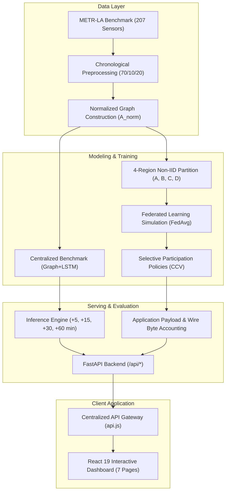

# TrafficPulse-X

> Federated traffic-speed forecasting and communication-cost evaluation using METR-LA, Graph+LSTM, FedAvg, selective client participation, and an interactive analysis dashboard.

[](https://www.python.org/downloads/)
[](https://pytorch.org/)
[](https://fastapi.tiangolo.com/)
[](https://react.dev/)
[](https://vitejs.dev/)
[](#testing--verification)

---

## Problem Statement

Centralized intelligent transportation systems require continuous streaming of high-frequency sensor readings from municipal highway networks to a central datacenter. This paradigm faces critical operational limitations:

1. **Communication Bottlenecks**: Transmitting high-frequency telemetry across hundreds of loop detectors incurs substantial transmission costs and WAN congestion.
2. **Regional Heterogeneity (Non-IID Data)**: Highway sub-networks exhibit distinct local congestion patterns, bottleneck dynamics, and sensor densities, violating independent and identically distributed (IID) assumptions.
3. **Data Sovereignty & Privacy**: Centralizing telemetry across administrative boundaries poses governance challenges.
4. **Accuracy vs. Communication Trade-Off**: Standard evaluations report model accuracy in isolation without measuring the communication payload required to achieve it.

**TrafficPulse-X** evaluates whether decentralized federated training with selective client participation can match centralized forecast accuracy while reducing application-layer communication payload by **50% to 75%**.

---

## Key Features

- **METR-LA Speed Forecasting**: Evaluated on 207 inductive loop sensors on Los Angeles County freeways.
- **Spatio-Temporal Graph+LSTM**: Joint architecture combining Chebyshev spectral graph convolutions with recurrent LSTM cells.
- **Multi-Horizon Projections**: Simultaneous forecasts at +5, +15, +30, and +60-minute horizons.
- **Centralized Benchmark**: Multi-model comparison across 7 baseline architectures.
- **4-Region Federated Simulation**: Decentralized FedAvg training across 4 non-IID geographic client sectors.
- **Selective Client Participation**: Client Contribution Value (CCV) policy scheduling evaluating 4 communication budget tiers.
- **Communication Payload Accounting**: Authoritative measurement of serialized model weight transfers (110,271 Bytes per client/round).
- **Controlled Local Network-Byte Measurement**: Localhost socket benchmark quantifying HTTP/TCP framing overhead (+0.298%).
- **Decision Intelligence**: Dynamic 9-factor Need Score engine and Sensor Jury consensus for on-demand sensing.
- **Traffic Network Visualization**: Interactive 207-sensor spatial Leaflet map with regional filtering and playback controls.
- **Historical Replay Engine**: Deterministic playback over 34,272 METR-LA observations (March–June 2012) at 5-minute granularity.
- **Live Data Streaming Adapter**: Pluggable provider interface (Historical Replay default; unconfigured streams report 503 without fake fallback).
- **PeMS08 Traffic Flow Extension**: Verified public benchmark extension forecasting traffic flow volume (veh/5min) across 170 sensors in District 8.
- **Differential Privacy Add-On**: Evaluated Opacus DP-FedAvg experiment providing verified $(\epsilon = 5.311, \delta = 10^{-5})$-DP bounds.

---

## System Architecture



---

## Application Pages

The frontend console provides 7 canonical routes:

| Route | View Name | Key Components & Purpose |
| :--- | :--- | :--- |
| **`/overview`** | **Executive Overview** | System operational health, KPI summary cards, and next 60-minute network outlook. |
| **`/network`** | **Tactical Traffic Network** | Interactive 207-sensor Leaflet map, regional cluster filtering, and historical replay controls. |
| **`/predictions`** | **Traffic Forecasting** | Multi-horizon forecasts (+5m to +60m), uncertainty intervals, and 7-model comparative benchmark. |
| **`/decision`** | **Decision Intelligence** | 9-factor Need Score breakdown, Next-Best Query ranking, and Sensor Jury consensus gating. |
| **`/federated`** | **Federated Learning Grid** | 4-client non-IID partition cards, Round 8 convergence history, 3-seed reproducibility, and DP bounds. |
| **`/communication`** | **Communication Intelligence** | CCV selective policies, 50% application payload reduction, and controlled network wire metrics. |
| **`/alerts`** | **Live Alert Monitor** | Real-time incident event stream with replay-synchronized speed anomalies and indicators. |

---

## Datasets & Forecasting Specification

### Primary Benchmark: METR-LA
- **Sensors**: 207 inductive loop detectors across Los Angeles County highways.
- **Temporal Span**: March 1, 2012 to June 27, 2012 (34,272 timesteps at 5-minute intervals).
- **Target Variable**: Vehicle speed (`mph`).
- **Data Splits**: Chronological 70% Train (23,967) | 10% Validation (3,404) | 20% Test (6,832).
- *Boundary Disclosure*: METR-LA provides vehicle speed only. Flow, occupancy, and incident ground truth are not present in this dataset.

### Optional Flow Extension: PeMS08
- **Sensors**: 170 loop detector stations in Caltrans District 8 (San Bernardino).
- **Temporal Span**: July 1, 2016 to August 31, 2016 (17,856 timesteps at 5-minute intervals).
- **Target Variable**: Traffic flow volume (`veh/5min`, mean: 230.22).
- Maintained as an isolated dataset extension in `data/processed/pems08/`.

### Forecasting Input & Horizons
- **Input Sequence**: 12 historical 5-minute observations (60 minutes).
- **Forecast Horizons**: **+5 min** (step 1), **+15 min** (step 3), **+30 min** (step 6), **+60 min** (step 12).
- **Model Tensor Shape**: `[B, 12, 207, 2]` (Channel 0: z-score normalized speed, Channel 1: sensor validity mask).

---

## Federated Setup

The 207 sensors are partitioned into 4 geographic regional client clusters:

| Regional Client | Sector | Sensor Count | Valid Target Samples ($n_i$) | FedAvg Weight ($w_i$) |
| :--- | :--- | :---: | :---: | :---: |
| **Region A** | North-East (Glendale / Griffith Park) | **48** | 4,221,681 | `0.229069` |
| **Region B** | South-East (Downtown LA Arterial Core) | **57** | 5,107,193 | `0.277117` |
| **Region C** | Central-West (San Fernando Valley) | **58** | 5,150,335 | `0.279458` |
| **Region D** | North-West (East LA & San Gabriel) | **44** | 3,950,552 | `0.214357` |
| **Total** | — | **207** | **18,429,761** | **1.000000** |

- **Non-IID Partitioning**: Clients capture distinct geographic subgraphs with differing highway topologies and traffic dynamics.
- **Aggregation Protocol**: Weighted Federated Averaging (`FedAvg`) aggregating local model updates after 20 training steps per round.

---

## Verified Results

Empirical results evaluated across 6,832 test-set samples on METR-LA:

| Architecture | Test MAE (mph) | Test RMSE (mph) | Test MAPE (%) | Parameters | Best Epoch / Round |
| :--- | :---: | :---: | :---: | :---: | :---: |
| **Centralized Spatial Graph+LSTM** | **3.4378** | **6.8873** | **9.57%** | 26,596 | Epoch 12 |
| **FedAvg Decentralized (4 Clients)** | **3.5322** | **7.0956** | **9.99%** | 26,596 | Round 8 (Val MAE: 3.1536) |

$$\Delta \text{ (FedAvg vs Centralized)}: +0.0944\text{ mph} \text{ (+2.75\%) MAE penalty under decentralized training with 100\% data locality.}$$

### Centralized 7-Model Benchmark Matrix

| Model Architecture | Category | Overall MAE | Overall RMSE | Overall MAPE | +60 min MAE |
| :--- | :--- | :---: | :---: | :---: | :---: |
| **Historical Average** | Classical Baseline | 4.1930 | 7.8618 | 13.06% | **4.1934** |
| **Last Value (Persistence)** | Classical Baseline | 3.9839 | 7.6411 | 10.15% | 5.3987 |
| **Linear Regression** | Linear Baseline | 3.9763 | 7.2053 | 11.14% | 5.5879 |
| **Temporal GRU** | Recurrent Deep Learning | 3.5669 | 7.0734 | 10.14% | 4.9284 |
| **Temporal LSTM** | Recurrent Deep Learning | 3.5613 | 7.0673 | 10.11% | 4.9156 |
| **Spatial GCN** | Spatial Graph Convolution | 5.4604 | 8.9625 | 15.67% | 6.4201 |
| **SpatialGraphLSTM** | Joint Spatio-Temporal | **3.4378** 🏆 | **6.8873** 🏆 | **9.57%** 🏆 | 4.7158 |

---

## Communication Evaluation

### Application Payload Accounting (Authoritative Project Metric)
Model update transfer size: **110,271 Bytes** per client per round (serialized PyTorch state dict).

| Policy Tier | Active Clients / Round | Total Transfers (13 Rds) | Application Payload | Reduction vs. Full |
| :---: | :---: | :---: | :---: | :---: |
| **4/4 (Full)** | 4 | 104 | 11,468,184 B (11.47 MB) | Baseline (0.0%) |
| **3/4** | 3 | 78 | 8,601,138 B (8.60 MB) | 25.0% |
| **2/4** | 2 | 52 | **5,734,092 B (5.73 MB)** | **50.0% (Pareto-Optimal)** |
| **1/4** | 1 | 26 | 2,867,046 B (2.87 MB) | 75.0% |

*Note: Figures reflect application-layer serialized PyTorch tensor parameters without speculative transport assumptions.*

### Secondary Benchmark: Controlled Network Transfer Bytes
Measured over local loopback sockets (`127.0.0.1:8000`) over HTTP/1.1 to quantify wire framing and HTTP header overhead:
- **4/4 Full Policy**: 11,502,380 measured wire bytes (+34,196 bytes / +0.298% transport overhead).
- **2/4 50% Policy**: 5,751,190 measured wire bytes (+17,098 bytes / +0.298% transport overhead).
- *Scientific Boundary: Local socket transport measurement; not a cellular radio link simulation.*

---

## Streaming Modes & Data Integrity

- **Historical Replay (Default)**: Deterministic playback over 34,272 METR-LA timestamps.
- **External Stream (Optional)**: Pluggable adapter interface. If external API configuration is absent, the backend explicitly returns `503 Service Unavailable / Not Configured`.
- **Integrity Guarantee**: The system never falls back to fabricated or synthetically randomized telemetry when external streams are unavailable.

---

## Technology Stack

- **Backend / Machine Learning**:
  - Python 3.10+
  - PyTorch (`torch>=2.0.0`)
  - FastAPI (`fastapi>=0.110.0`) & Uvicorn (`uvicorn>=0.28.0`)
  - NumPy, Pandas, SciPy, PyTables, H5py
  - Opacus (`opacus>=1.4.0`, optional differential privacy module)
  - Pytest (`pytest>=8.0.0`), HTTPX (`httpx>=0.27.0`)
- **Frontend / Dashboard**:
  - React 19 (`react^19.2.8`, `react-dom^19.2.8`)
  - React Router (`react-router-dom^7.18.4`)
  - Leaflet & React-Leaflet (`leaflet^1.9.4`, `react-leaflet^5.0.0`)
  - Recharts (`recharts^3.10.1`)
  - Tailwind CSS v4 (`tailwindcss^4.3.3`)
  - Lucide React (`lucide-react^1.52.0`)
  - Vite (`vite^8.3.0`), Oxlint (`oxlint^1.81.0`)

---

## Repository Structure

```text
src/
├── app/                               # Root React application shell & route definitions
├── backend/                           # FastAPI REST application (53 production endpoints)
│   ├── communication_intelligence/    # CCV scheduling policies & wire accounting
│   ├── data_sources/                  # Dataset streaming adapters (METR-LA & PeMS08)
│   ├── datasets/                      # Graph loaders & normalized Laplacian builders
│   ├── decision/                      # 9-factor Need Score engine & Sensor Jury consensus
│   ├── experiments/                   # PeMS08 flow router & transport socket benchmarks
│   ├── federated/                     # FedAvg consensus service & regional partitions
│   ├── privacy/                       # Differential privacy accountant router
│   ├── main.py                        # FastAPI entrypoint
│   └── test_*.py (22 files)           # Automated integration test suite (343 tests)
├── components/                        # Modular React UI components (traffic, prediction, etc.)
├── context/                           # Global state management (ReplayContext & ThemeContext)
├── data/
│   ├── processed/metr-la/             # Preprocessed METR-LA arrays, regions & checkpoints
│   └── processed/pems08/              # PeMS08 flow extension data & trained weights
├── ml/                                # Machine learning models & training routines
│   ├── experiments/                   # 3-seed reproducibility & IID benchmarks
│   ├── federated/                     # FedAvg simulation engine
│   ├── privacy/                       # Opacus DP-SGD training harness
│   └── spatiotemporal/                # SpatialGraphLSTM neural network
├── pages/                             # 7 canonical page views
├── services/                          # Centralized frontend API gateway (api.js)
├── index.html                         # Vite application entrypoint HTML
├── package.json                       # Frontend dependencies & npm scripts
├── requirements.txt                   # Backend Python dependencies
└── vite.config.js                     # Vite build configuration
```

---

## Installation & Running Locally

### Prerequisites
- **Python 3.10+**
- **Node.js 18+** with `npm`
- **Git**

### Step 1: Environment Setup

```bash
# 1. Create and activate a Python virtual environment
python -m venv .venv

# On Windows (PowerShell):
.\.venv\Scripts\Activate.ps1

# On Linux / macOS (Bash):
source .venv/bin/activate

# 2. Upgrade pip and install backend dependencies
python -m pip install --upgrade pip
python -m pip install -r requirements.txt

# 3. Install frontend JavaScript dependencies
npm install
```

### Step 2: Running the Services

Open two terminal sessions inside `src/`:

#### Terminal 1: Backend API Server (FastAPI)
```bash
# Windows / Linux:
python -m uvicorn backend.main:app --host 127.0.0.1 --port 8000
```
- **FastAPI Backend**: `http://127.0.0.1:8000`
- **Interactive Swagger Docs**: `http://127.0.0.1:8000/docs`
- **Health Check**: `http://127.0.0.1:8000/api/health`

#### Terminal 2: Frontend Operations Dashboard (React + Vite)
```bash
npm run dev -- --host 127.0.0.1 --port 5173
```
- **Operations Console**: Open `http://127.0.0.1:5173/` in your browser.

---

## Testing & Verification

Run the verification commands to confirm complete system integrity:

```bash
# 1. Run full backend automated test suite (343 tests passing)
python -m pytest backend -q

# 2. Check frontend code quality with Oxlint (0 errors)
npm run lint

# 3. Verify production frontend build with Vite
npm run build
```

---

## API Overview

All routes are hosted on the FastAPI backend under `/api/*`:

- `/api/health` — System status, uptime, and component health.
- `/api/datasets/*` — METR-LA metadata, regional partitions, and road graph topology.
- `/api/predictions/*` — Multi-horizon forecasts (+5m to +60m), 7-model benchmark, and telemetry series.
- `/api/federated/*` — FedAvg status, client partition profiles, round convergence, and 3-seed reproducibility.
- `/api/decision/*` — 9-factor Need Score breakdown, Next-Best Query ranking, and Sensor Jury consensus.
- `/api/communication/*` — CCV policy evaluation, application payload accounting, and wire byte benchmarks.
- `/api/streaming/*` — Historical replay and optional external live streaming status.
- `/api/experiments/*` — PeMS08 flow extension, DP privacy accountant, and socket transfer overhead.

---

## Scientific Scope & Limitations

1. **Historical Replay as Primary Execution**: All demonstrations use deterministic replay of the METR-LA benchmark (34,272 observations). No claims are made of active municipal live deployments.
2. **Application Payload Accounting**: Telemetry reduction is reported strictly as **Application Payload** (serialized tensor bytes: 110,271 B / round). Cellular radio bandwidth savings are not claimed.
3. **Controlled Transport Benchmark**: Network-byte measurements are conducted over localhost sockets (`127.0.0.1`) to quantify HTTP/1.1 protocol framing, not field wireless links.
4. **Differential Privacy Boundaries**: Formal $(\epsilon = 5.311, \delta = 10^{-5})$-DP guarantees apply exclusively to the optional Opacus DP-FedAvg experiment add-on, not the standard FedAvg baseline.
5. **No Fabricated Data**: Unconfigured external streaming endpoints report `503 Service Unavailable` without synthetic or randomized fallback.

---

## Academic References

1. **McMahan, B., Moore, E., Ramage, D., Hampson, S., & y Arcas, B. A.** (2017). *Communication-Efficient Learning of Deep Networks from Decentralized Data*. AISTATS. [https://arxiv.org/abs/1602.05629](https://arxiv.org/abs/1602.05629)
2. **Li, Y., Yu, R., Shahabi, C., & Liu, Y.** (2018). *Diffusion Convolutional Recurrent Neural Network: Data-Driven Traffic Forecasting*. ICLR. [https://arxiv.org/abs/1707.01926](https://arxiv.org/abs/1707.01926)
3. **Yu, B., Yin, H., & Zhu, Z.** (2018). *Spatio-Temporal Graph Convolutional Networks: A Deep Learning Framework for Traffic Forecasting*. IJCAI. [https://arxiv.org/abs/1709.04875](https://arxiv.org/abs/1709.04875)
4. **Jaggi, M. et al.** (2014). *Communication-Efficient Distributed Dual Coordinate Ascent*. NeurIPS. [https://arxiv.org/abs/1409.1458](https://arxiv.org/abs/1409.1458)
5. **Hochreiter, S., & Schmidhuber, J.** (1997). *Long Short-Term Memory*. Neural Computation. [https://doi.org/10.1162/neco.1997.9.8.1735](https://doi.org/10.1162/neco.1997.9.8.1735)
6. **METR-LA Benchmark Dataset**: Los Angeles County Highway Network via Caltrans PeMS. [https://github.com/liyaguang/DCRNN](https://github.com/liyaguang/DCRNN)
7. **Caltrans Performance Measurement System (PeMS)**: California Department of Transportation. [https://dot.ca.gov/programs/traffic-operations/mpr/pems-source](https://dot.ca.gov/programs/traffic-operations/mpr/pems-source)
8. **Differential Privacy / DP-SGD**: Abadi et al. (2016). [https://arxiv.org/abs/1607.00133](https://arxiv.org/abs/1607.00133)
9. **Practical Secure Aggregation**: Bonawitz et al. (2017). [Google Research](https://research.google/pubs/practical-secure-aggregation-for-privacy-preserving-machine-learning/)
10. **Federated Learning on Non-IID Data**: Sattler et al. (2019). [IEEE Xplore](https://ieeexplore.ieee.org/document/8889996)
