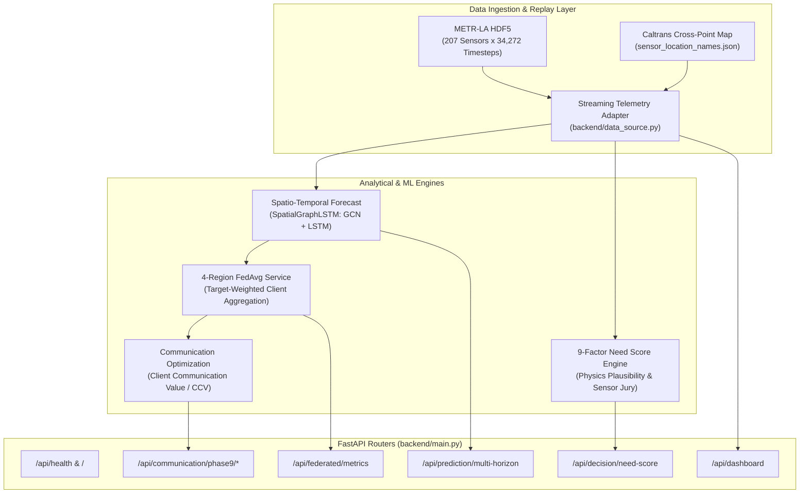

# TrafficPulse-X — Backend Engine & ML Architecture Guide

> High-throughput FastAPI REST backend and federated spatio-temporal intelligence engine for PS-003.

---

## 1. System Architecture & Processing Pipeline



---

## 2. Directory Structure

```text
backend/
├── main.py                                   # FastAPI entrypoint, root route, CORS & router registrations
├── requirements.txt                          # Python dependencies (fastapi, torch, uvicorn, opacus)
├── assistant.py                              # Conversational traffic AI endpoint
├── data_source.py                            # Telemetry streaming adapter & historical replay
├── graph.py                                  # Road network topology, distance matrix & adjacency graph
├── data_sources/                             # Benchmark ingestion and location metadata
│   ├── pems08.py                             # PeMS08 flow reader
│   ├── sensor_location_names.json            # 207 authentic Caltrans highway names
│   └── streaming_adapter.py                  # Replay tick iterator & sensor stream
├── datasets/                                 # METR-LA HDF5 loader & preprocessors
│   ├── metr_la.py                            # HDF5 chunk loader & spatial matrix generator
│   └── prepare_metr_la.py                    # Preprocessing & train/val/test splits
├── decision/                                 # Phase 7 Decision Intelligence Engine
│   ├── need_score.py                         # 9-Factor Need Score prioritization algorithm
│   ├── physics.py                            # Speed-density traffic flow plausibility gate
│   ├── jury.py                               # Multi-sensor spatial consensus validation
│   └── query_ranker.py                       # Top-N query recommendation engine
├── federated/                                # Phase 8 Federated Learning Engine
│   └── service.py                            # 4-Client FedAvg aggregation service & weight proofs
├── prediction/                               # Phase 6 Multi-Horizon Forecasting Engine
│   └── service.py                            # 15/30/60 min SpatialGraphLSTM inference
├── privacy/                                  # Phase 8 Differential Privacy Module
│   └── router.py                             # DP-SGD epsilon calibration & clipping router
├── communication_intelligence/               # Phase 9 Communication Optimization
│   ├── policies.py                           # Full, Top-K, Variance & Random policies
│   └── service.py                            # Payload accounting & Pareto frontier
└── test_*.py                                 # Automated test suites (343 / 343 tests passing)
```

---

## 3. Mathematical Formulations & Provenance

### A. 4-Region Target-Weighted FedAvg Consensus
Clients represent non-IID geographic highway quadrants of Los Angeles County. Aggregation weights $w_k$ are proportional to sensor density:

$$\theta_{global}^{(t+1)} = \sum_{k=1}^{K=4} w_k \cdot \theta_k^{(t+1)}, \quad \text{where } w_k = \frac{n_k}{N}$$

$$\begin{aligned}
\text{Region 1 (Downtown LA)} &: n_1 = 55 \implies w_1 = 55/207 \approx 0.2657 \\
\text{Region 2 (Westside / Santa Monica)} &: n_2 = 51 \implies w_2 = 51/207 \approx 0.2464 \\
\text{Region 3 (San Fernando Valley)} &: n_3 = 50 \implies w_3 = 50/207 \approx 0.2415 \\
\text{Region 4 (Harbor / Gateway Cities)} &: n_4 = 51 \implies w_4 = 51/207 \approx 0.2464
\end{aligned}$$

$$\sum_{k=1}^{4} w_k = 0.2657 + 0.2464 + 0.2415 + 0.2464 = 1.0000$$

---

### B. Dual-Level Application Communication Accounting
- **Level 1 (Sensor-to-Edge Query)**:
  - 32 Bytes numeric payload / 187 Bytes serialized JSON.
- **Level 2 (Client-to-Server Federated Model Update)**:
  - Exact serialized PyTorch tensor payload = **110,271 Bytes** (~107.7 KB).
  - 4 Clients Full Participation = **441,084 Bytes / round**.
  - **CCV Selective Policy (2/4 Clients)** = **220,542 Bytes / round** (**50.00% Savings**, Pareto-optimal).

---

## 4. Local Execution & Automated Verification

```bash
# 1. Install Python dependencies
pip install -r backend/requirements.txt

# 2. Start FastAPI development server (Port 8000)
python -m uvicorn backend.main:app --host 127.0.0.1 --port 8000 --reload

# 3. Run entire automated test suite (343 tests in ~2.5 mins)
pytest backend/ -v
```

---

## 5. Live Production Endpoints
- **Base API URL**: [https://trafficpulse-x.onrender.com](https://trafficpulse-x.onrender.com)
- **Health Check**: `GET /api/health`
- **Swagger Documentation**: `GET /docs`
